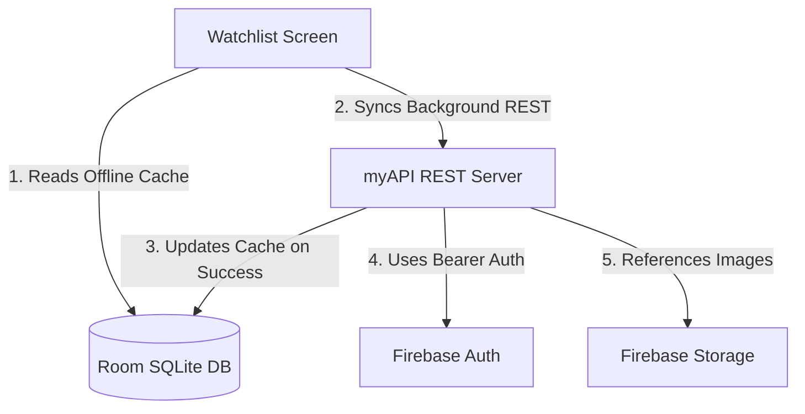

# Movie Watchlist API Reference Guide (Three-Tier Architecture)

This guide is optimized for developers and coding agents to understand, mock, or implement the REST API and coordinates a **three-tier storage architecture**:
1. **Primary Data Storage**: `myAPI` REST server (managing movie metadata and watchlist states).
2. **Local Backup & Cache**: `Room DB` (local SQLite database for offline-first support and caching).
3. **Authentication & Images**: `Firebase Auth` (user authentication) and `Firestore/Firebase Storage` (hosting and managing movie poster images).

---

## 1. Global API Configuration & Security

* **Base URL**: `http://127.0.0.1:8000/` (or `http://10.0.2.2:8000/` for local Android Emulators)
* **Firebase Bearer Authentication**: Secure access is enforced across all `/watchlist` routes.
  * **Authorization Header**: `Authorization: Bearer <firebase_uid>`
  * **Token Format**: The user's unique Firebase User `uid` string (retrieved from `FirebaseAuth.getInstance().currentUser?.uid`).
  * **Behavior**: Missing or empty bearer tokens immediately trigger `401 Unauthorized`. Watchlists are strictly isolated under this Firebase UID string, providing transparent, secure multi-tenancy.

---

## 2. Watchlist Schema (`MovieRead` JSON)

The REST API accepts, stores, and returns the following movie payload fields:

| Field Name | JSON Type | Description |
| :--- | :--- | :--- |
| `id` | `integer` | Unique auto-incrementing movie ID generated by the REST server. |
| `title` | `string` | Title of the movie. |
| `genre` | `string` | Comma-separated list of genres. |
| `description` | `string` | Movie plot summary. |
| `priority` | `string` | `"High"`, `"Medium"`, or `"Low"` (default `"Medium"`). |
| `is_watched` | `boolean` | Watched state flag. |
| `is_favorite` | `boolean` | Favorite state flag. |
| `release_date` | `string` | Release year. |
| `poster_url` | `string` | Public URL hosting the poster image (hosted on Firebase Storage). |
| `user_id` | `string` | Unique string **Firebase UID** owning the movie (enforces absolute tenant isolation). |

---

## 3. Endpoints Directory

### A. List Watchlist (Scoped & Isolated)
* **Route**: `GET /watchlist`
* **Headers**: `Authorization: Bearer <firebase_uid>`
* **Success Response (`200 OK`)**: Returns an array of `MovieRead` objects **belonging only to the calling Firebase User**. No other user's movies will be visible in the list.

### B. Add Movie
* **Route**: `POST /watchlist`
* **Headers**: `Authorization: Bearer <firebase_uid>`
* **Request Body**: (Accepts standard movie fields. `user_id` is automatically set by the server to match the calling Firebase UID).
  * **Example Request**:
    ```json
    {
      "title": "Interstellar",
      "genre": "Sci-Fi, Drama",
      "description": "A team of explorers travel through a wormhole in space.",
      "poster_url": "https://firestore.googleapis.com/v1/projects/filmfolio/storage/posters/interstellar.jpg"
    }
    ```
* **Success Response (`201 Created`)**: Returns the completed `MovieRead` object.

### C. Retrieve Movie Details
* **Route**: `GET /watchlist/{movie_id}`
* **Headers**: `Authorization: Bearer <firebase_uid>`
* **Success Status Code**: `200 OK`
* **Failure Status Codes**: `404 Not Found` if the movie does not exist or belongs to another user.

### D. Modify / Delete Movie (Ownership Enforced)
* **Routes**: 
  * `PUT /watchlist/{movie_id}`
  * `DELETE /watchlist/{movie_id}`
* **Headers**: `Authorization: Bearer <firebase_uid>`
* **Behavior**: The server checks that the movie with ID `{movie_id}` exists AND belongs to the Firebase User matching the token. If not, it throws a `404 Not Found` to mask other users' data, securing the database against horizontal privilege escalation.

---

## 4. Room DB Backup & Caching Integration (Client-Side)

To coordinate our three-tier architecture in the Android application, use the following offline-first synchronization strategy:



1. **Instant UI Load**: The repository queries the local `Room DB` (`MovieDao`) using reactive `Flow<List<Movie>>`. The UI loads instantly without network lag, providing offline support.
2. **Background Sync**: Simultaneously, the repository triggers a background call to `MovieApiService.getWatchlist()`.
3. **Database Alignment**: Once the REST API response is received, the repository synchronizes the data into Room (overwriting outdated fields, adding new items, and deleting removed records), backing up your remote REST server data locally.
4. **Transparent Auth**: OkHttp's Interceptor automatically queries `FirebaseAuth.getInstance().currentUser?.uid` and appends it to all requests, ensuring seamless user isolation.
